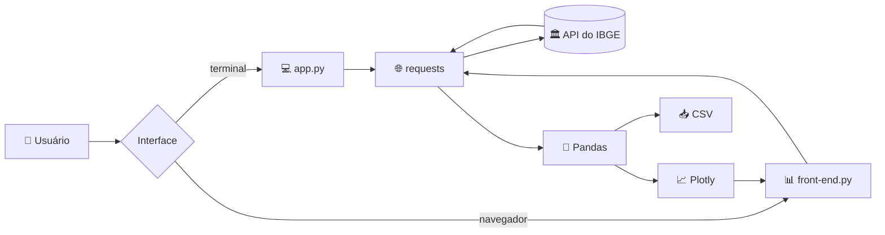
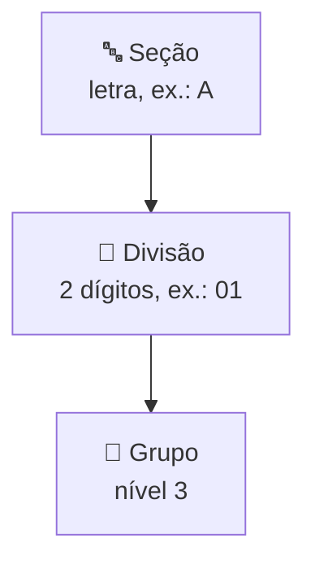

<div align="center">

# 🏭 API CNAE

### Explore a Classificação Nacional de Atividades Econômicas com dados oficiais do IBGE


[📖 Sobre](#-sobre-o-projeto) •
[✨ Funcionalidades](#-funcionalidades) •
[🔌 API utilizada](#-api-utilizada) •
[🚀 Como executar](#-como-executar) •
[📂 Estrutura](#-estrutura-do-projeto) •
[🗺️ Roadmap](#️-roadmap)

</div>

---

## 📖 Sobre o projeto

O **API CNAE** consome a API pública de **Serviço de Dados do IBGE** para consultar a **CNAE (Classificação Nacional de Atividades Econômicas)**, o padrão usado no Brasil para classificar a atividade econômica de empresas.

O projeto traz **duas formas de explorar os mesmos dados**:

| | Interface | Arquivo | Para quem é |
|---|---|---|---|
| 💻 | **Menu no terminal** | `app.py` | Consulta rápida de seções e divisões |
| 📊 | **Painel web interativo** | `front-end.py` | Navegar, filtrar, buscar, visualizar gráficos e exportar CSV |

---

## ✨ Funcionalidades

### 📊 Painel web (Streamlit)

| | Página | O que oferece |
|---|---|---|
| 🏠 | **Visão geral** | Indicadores (KPIs) de seções, divisões, grupos e média de divisões por seção, além de gráficos de barras, rosca e barras horizontais |
| 🗂️ | **Seções** | Cards coloridos por seção com filtro por texto e exportação em CSV |
| 📑 | **Divisões** | Tabela filtrável por seção e por descrição, com exportação em CSV |
| 🌳 | **Hierarquia** | Escolha uma seção e uma divisão para ver os grupos que a compõem |
| 🔎 | **Busca** | Pesquisa global em seções, divisões e grupos ao mesmo tempo, ignorando acentos e maiúsculas |

Extras do painel:

- ⚡ **Cache de 1 hora** nos dados, para o painel carregar rápido
- 🔄 Botão **Atualizar dados** para forçar nova consulta ao IBGE
- 📥 **Exportação em CSV** (separador `;` e codificação `utf-8-sig`, compatível com Excel)
- 🛡️ Tratamento de erro quando a API do IBGE está inacessível

### 💻 Menu no terminal

```
========== API Atividades Econômicas ==========
1. Listar todas as Seções
2. Listar todas as Divisões
3. Sair
----------
Digite o número da sua opção:
```

---

## 🔌 API utilizada

Os dados vêm diretamente da API de CNAE do IBGE, sem necessidade de chave de acesso.

**Base:** `https://servicodados.ibge.gov.br/api/v2/cnae`

| Endpoint | Retorna | Usado em |
|---|---|---|
| `/secoes` | Seções (nível 1, letras) | Terminal e painel |
| `/divisoes` | Divisões (nível 2, 2 dígitos) | Terminal e painel |
| `/grupos` | Grupos (nível 3) | Painel |

---

## 🔄 Fluxo da aplicação



---

## 🧭 Hierarquia da CNAE



---

## 🛠️ Tecnologias

| Tecnologia | Uso |
|---|---|
| 🐍 **Python** | Linguagem principal |
| 🌐 **Requests** | Consumo da API do IBGE |
| 🖥️ **Streamlit** | Painel web interativo |
| 🐼 **Pandas** | Organização e filtro dos dados |
| 📈 **Plotly Express** | Gráficos de barras e rosca |

---

## 🚀 Como executar

### Pré-requisitos

- [Python 3.10+](https://www.python.org/downloads/)
- [Git](https://git-scm.com/)
- Conexão com a internet (os dados são buscados na API do IBGE)

### Passo a passo

```bash
# 1️⃣ Clone o repositório
git clone https://github.com/julianabcor/API-CNAE.git
cd API-CNAE

# 2️⃣ Crie e ative o ambiente virtual
python -m venv venv
source venv/bin/activate        # Linux/macOS
venv\Scripts\activate           # Windows

# 3️⃣ Instale as dependências
pip install -r requirements.txt
```

### ▶️ Rodando

**📊 Painel web (recomendado)**

```bash
streamlit run front-end.py
```

Depois é só abrir 👉 **http://localhost:8501**

**💻 Menu no terminal**

```bash
python app.py
```

---

## 📂 Estrutura do projeto

```
📦 API-CNAE
 ┣ 📜 app.py             # Menu no terminal (seções e divisões)
 ┣ 📜 front-end.py       # Painel web com Streamlit + Plotly
 ┣ 📜 requirements.txt   # Dependências do projeto
 ┗ 📜 README.md
```

---

## 🗺️ Roadmap

- [x] Menu no terminal com seções e divisões
- [x] Painel web com visão geral, seções, divisões, hierarquia e busca
- [x] Gráficos interativos com Plotly
- [x] Exportação de dados em CSV
- [x] Cache e tratamento de erros da API
- [ ] Incluir os níveis de **classes** e **subclasses** da CNAE
- [ ] Consulta de uma atividade pelo código CNAE
- [ ] Deploy online do painel

---

## 🤝 Contribuindo

Contribuições são bem-vindas!

1. Faça um fork do projeto
2. Crie uma branch: `git checkout -b minha-feature`
3. Commit: `git commit -m "Adiciona minha feature"`
4. Push: `git push origin minha-feature`
5. Abra um Pull Request

---

## 📊 Fonte dos dados

Os dados são fornecidos pelo **IBGE** (Instituto Brasileiro de Geografia e Estatística) através do portal [servicodados.ibge.gov.br](https://servicodados.ibge.gov.br).

---

## 👩‍💻 Autora

<div align="center">

Feito com 💜 por **Juliana**

[](https://github.com/julianabcor)

⭐ Se gostou do projeto, deixe uma estrela!

</div>
